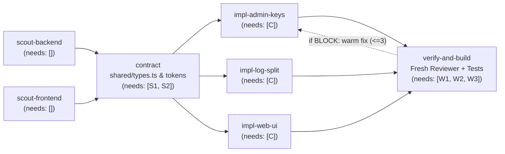

# lead-orchestrator

[](../LICENSE)
[](https://github.com/XRSec/lead-orchestrator)
[](#supported-environments)

English | [简体中文](./README.zh-CN.md)

**Turn your AI coding session into a Tech Lead that delegates, parallelizes, and reviews.**

Drop in a complex, multi-part requirement as usual. Instead of stuffing 40 files into one bloated chat window—or running subagents one by one—`lead-orchestrator` automatically compiles your request into a **GitHub Actions–style `jobs + needs` dependency graph**, runs independent coding subagents **in parallel**, and gates delivery with an **independent fresh-context reviewer**.

---

## Why Use This Skill?

When you hand a large task to a single AI agent session, context fills up fast: earlier requirements get forgotten, edits take forever serially, and the same agent "reviews" its own code with the same blind spots.

| What Usually Happens | With `/lead-orchestrator` |
| --- | --- |
| **Context bloat**: Reading 30+ files and test logs pollutes the main thread until reasoning degrades | **Clean main brain**: Your main chat stays a coordinator—recon, coding, and test runs happen in isolated subagent contexts |
| **Slow serial execution**: Tasks run one after another (or stall behind rigid full-wave barriers) | **Event-driven `jobs + needs` parallelism**: Ready jobs launch together; the moment *any* job finishes, its dependents unlock immediately |
| **Subagent file collisions**: Parallel workers overwrite shared files or fail on dirty git checkouts | **Smart boundary isolation**: Extracts shared contracts (`types.ts`, tokens) upfront, locks workers to non-overlapping files, or uses Git worktrees when clean |
| ** Rubber-stamp self-review**: The author checks its own diff and misses edge cases | **Fresh-context adversarial gate**: A separate read-only `Verifier` runs real builds/tests and routes defects back to the exact warm `Implementer` |

---

## What Happens When You Run It? (30-Second Example)

You write **normal product requirements**—no manual subagent prompts or wave choreography needed:

```text
/lead-orchestrator
1. Deleting an old admin wipes probe API keys — transfer ownership instead.
2. Redesign the web dashboard and modals with our UI design tokens.
3. Separate interactive terminal logs from scheduled cron task logs.
4. Auto-fill API keys in the probe install modal instead of manual dropdowns.
```

Behind the scenes, the main session automatically builds and drives an async `jobs + needs` DAG:



1. **Parallel Recon (`Scout`)**: Maps backend/DB and frontend files simultaneously without bloating your main chat.
2. **Thin Contract Split**: Pulls out tiny shared changes (`shared/types.ts`, CSS variables) first so frontend and backend don't block each other for 10 minutes.
3. **Parallel Coding (`Implementer`)**: Launches multiple scoped coders at once on non-colliding file paths (or isolated Git worktrees).
4. **Independent Gate (`Verifier`)**: Spawns a brand-new session with zero file-edit permissions to run the real build/test suite and audit every requirement verbatim.

---

## Installation

### Option 1: Skills CLI (Claude Code / Agents / Cursor / Codex)
```bash
npx skills add XRSec/lead-orchestrator
```

### Option 2: Pi Coding Agent (`pi-subagents` & Cindy)
```bash
pi install git:github.com/XRSec/lead-orchestrator
```

### Option 3: Git Clone + Symlinks
```bash
git clone https://github.com/XRSec/lead-orchestrator.git ~/.agents/skills/lead-orchestrator
ln -s ~/.agents/skills/lead-orchestrator ~/.claude/skills/lead-orchestrator
ln -s ~/.agents/skills/lead-orchestrator ~/.gemini/config/skills/lead-orchestrator
```

---

## Usage

Just prefix your task with `/lead-orchestrator` (or `/skill:lead-orchestrator` in Pi). It automatically picks the right execution shape—or you can pass optional bracket hints:

| Command | When to Use |
| --- | --- |
| `/lead-orchestrator <task>` | **Default** — Auto-routes to single-lane, parallel `jobs + needs` DAG, or spec-first workflow |
| `/lead-orchestrator [focus] <task>` | Focused single-module bugfix or root-cause investigation + fresh verification |
| `/lead-orchestrator [swarm] <task>` | Force multi-lane parallel subagents across independent modules or audit angles |
| `/lead-orchestrator [best-of-n] <task>` | Build 2+ competing approaches in isolated Git worktrees, benchmark them, and merge the winner |
| `/lead-orchestrator [team] <task>` | Ambiguous or architectural project: parallel recon → clarify 1–3 key decisions → manifest DAG |
| `/lead-orchestrator [skip-interview] <task>` | Run `Team` mode immediately with explicit recorded assumptions (no upfront Q&A pause) |

---

## Supported Environments & Microkernel Layout

<a id="supported-environments"></a>
`lead-orchestrator` stays **~56 lines at the root** so it never wastes your context window on other platforms' instructions—loading only **1 host adapter** + **1 topology mode** + **5 built-in specialist profiles**:

```text
lead-orchestrator/
├── SKILL.md                    # 56-line Root Router + Reactive jobs + needs Scheduler
├── runtimes/                   # Loads ONLY your current host environment:
│   ├── claude-code.md          #   • Claude Code 2.1+ (background Agent + SendMessage + worktree)
│   ├── antigravity.md          #   • Antigravity / AGY (define_subagent + invoke_subagent + run_workflow)
│   └── pi.md                   #   • Pi (native pi-subagents JS workflow & Cindy cindy_subagent)
├── modes/                      # Loads ONLY the matching task topology:
│   ├── focus.md                #   • Single-module deep loop
│   ├── swarm.md                #   • Contract-split parallel jobs + needs DAG & Best-of-N
│   └── team.md                 #   • Spec-to-delivery DAG with scratch TASK_MANIFEST.md
└── profiles/                   # Self-contained specialist roles (no external ~/.agent/*.md needed):
    ├── scout.md                #   • Fast read-only codebase mapper
    ├── investigator.md         #   • Hypothesis-falsifying debugger & architecture oracle
    ├── implementer.md          #   • Boundary-locked code author
    ├── verifier.md             #   • Fresh-context read-only test & diff gatekeeper
    └── integrator.md           #   • Worktree merger, docs sync & user-consented Git actions
```

---

## Support

- **Afdian (爱发电 · WeChat / Alipay One-Time Tip)**: [https://ifdian.net/a/xrsec](https://ifdian.net/a/xrsec)

## License

[MIT](../LICENSE) © XRSec
