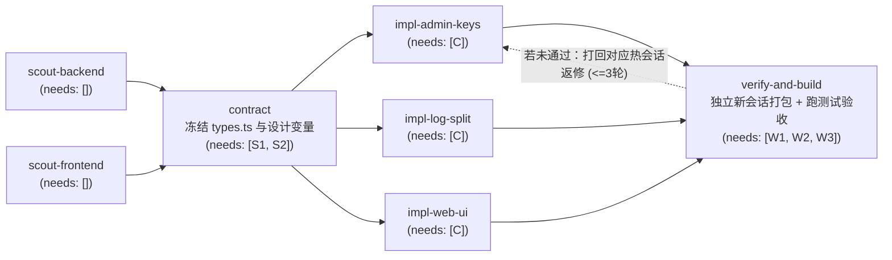

# lead-orchestrator

[](../LICENSE)
[](https://github.com/XRSec/lead-orchestrator)
[](#支持的运行环境与目录结构)

[English](./README.md) | 简体中文

**把你的 AI 编程主会话变成「只做拆解、并行调度与把关的 Tech Lead」。**

平时怎么提复杂需求就怎么提——不用自己拆子任务，也不用教 AI 怎么分波次。`lead-orchestrator` 会让主会话保持干净，自动把你的多点需求编译成类似 **GitHub Actions `jobs + needs` 的异步依赖图**，在后台**多路并行**拉起子代理写代码，最后派**全新上下文的独立审查员**跑真实测试验收。

---

## 它解决什么痛点？

直接让单个 AI 会话干一件跨前后端的大活时，往往会遇到三个老毛病：**上下文越聊越脏（忘需求）**、**单线程排队慢**、**自己写完自己审（顺着错的假设说没问题）**。

| 普通单会话 / 传统编排 | 使用 `/lead-orchestrator` 后 |
| --- | --- |
| **主对话塞满源码**：连读几十个文件加报错日志，后半程注意力下降、漏改细节 | **主脑零代码污染**：主会话只看坐标摘要、做架构调度；读代码、改文件、跑测试全在独立子会话完成 |
| **单线程排队干等**：一个模块改完再改下一个，或整波傻等最慢的任务 | **`jobs + needs` 事件驱动并发**：无依赖节点同时起跑；**任意子代理一跑完立刻解锁下游**，绝不陪跑傻等 |
| **多代理互踩文件**：多个子代理同时改公共文件互相覆盖，或在未提交的脏工作区开分支报错 | **自动抽契约 + 边界隔离**：先把 `types.ts` / 设计变量抽成极小前置节点，业务代码按互斥目录（或独立 Git Worktree）并行写 |
| **既当运动员又当裁判**：写代码的 AI 自己审自己，带着惯性思维漏掉边界 Bug | **独立冷启动对抗验收**：全新上下文的 `Verifier`（不改源码）实跑构建与单测，有问题精准打回原热会话返修（最多 3 轮） |

---

## 30 秒看懂实际效果

你只需要按自然语言丢进一串业务需求（完全不需要手写调度逻辑）：

```text
/lead-orchestrator
1. 添加新管理员后删掉老管理员会导致探针 API Keys 为空，改成平滑转移归属
2. 按设计规范重构 Web 面板与弹窗样式
3. 把「在线终端执行记录」从「定时任务日志」里解耦拆开
4. 绑定主机弹窗去掉手动选 API Key 下拉框，改成自动填充
```

主会话在后台会自动生成并驱动下面这张异步并发图：



1. **并发探路（`Scout`）**：分头快速摸清后端路由、数据库与前端视图坐标，不弄脏主会话上下文。
2. **微契约先行（`Contract`）**：先把前后端共用的几行接口类型确定下来，避免前端干等后端全部写完才能动工。
3. **多路并行实现（`Implementer`）**：3 路子代理在互不重叠的文件范围内同时编码。
4. **独立收口验收（`Verifier`）**：启动全新会话跑全量打包与测试，逐条核对你的原始需求；哪一路有问题就只唤醒哪一路返修。

---

## 安装方式

### 方式一：Skills CLI（Claude Code / Codex / Cursor / 通用 Agents）
```bash
npx skills add XRSec/lead-orchestrator
```

### 方式二：Pi Coding Agent（原生 `pi-subagents` & Cindy）
```bash
pi install git:github.com/XRSec/lead-orchestrator
```

### 方式三：手动克隆与软链
```bash
git clone https://github.com/XRSec/lead-orchestrator.git ~/.agents/skills/lead-orchestrator
ln -s ~/.agents/skills/lead-orchestrator ~/.claude/skills/lead-orchestrator
ln -s ~/.agents/skills/lead-orchestrator ~/.gemini/config/skills/lead-orchestrator
```

---

## 平时怎么用？

日常 95% 的场景只需在需求前加上 `/lead-orchestrator`（Pi 中为 `/skill:lead-orchestrator`），主脑会自动判断该走单模块闭环还是多路并行图；也可以加方括号指定模式：

| 命令写法 | 适用场景 |
| --- | --- |
| `/lead-orchestrator <需求>` | **默认推荐** — 自动判断单线任务、多路 `jobs + needs` 并行图或先澄清后开发 |
| `/lead-orchestrator [focus] <需求>` | 聚焦单个模块的 Bug 修复或深层根因排查 + 独立验收 |
| `/lead-orchestrator [swarm] <需求>` | 显式启用多子代理并发开发或多视角并行代码审计 |
| `/lead-orchestrator [best-of-n] <需求>` | 在多个独立 Git Worktree 中并行写出备选方案，实测比选后合入优胜版 |
| `/lead-orchestrator [team] <需求>` | 需求较模糊或大型跨模块改造：并行探路 → 最多问 1–3 个关键决策 → 清单驱动交付 |
| `/lead-orchestrator [skip-interview] <需求>` | 在 `Team` 模式下跳过提问环节，记录合理假设直接推进 |

---

## 支持的运行环境与目录结构

为了不浪费上下文，`SKILL.md` 根入口只有 **56 行微内核**，运行时只按需读取**当前宿主 1 份适配文件 + 当前模式 1 份规则 + 内置 5 个专家角色**（无需额外配置外部 `~/.agent/*.md`）：

```text
lead-orchestrator/
├── SKILL.md                    # 56 行微内核入口 + 响应式 jobs + needs 调度器
├── runtimes/                   # 自动识别并仅加载当前所处宿主：
│   ├── claude-code.md          #   • Claude Code 2.1+（后台 Agent + SendMessage + worktree）
│   ├── antigravity.md          #   • Antigravity / AGY（define_subagent + invoke_subagent + run_workflow）
│   └── pi.md                   #   • Pi（原生 pi-subagents JS 依赖图 & Cindy cindy_subagent）
├── modes/                      # 按任务复杂度加载对应拓扑：
│   ├── focus.md                #   • 单模块闭环（实施/排查 -> 独立验收 -> 热会话返修）
│   ├── swarm.md                #   • 契约剥离并行 jobs + needs 图 & Best-of-N 比武
│   └── team.md                 #   • 规格到交付全链路 DAG（含免跟踪 TASK_MANIFEST.md）
└── profiles/                   # 开箱即用的 5 个内置专家角色：
    ├── scout.md                #   • 快速只读探路与并行边界切分
    ├── investigator.md         #   • 假设证伪型根因排查 & 架构审视（Oracle）
    ├── implementer.md          #   • 锁定文件/分支边界的代码实施者
    ├── verifier.md             #   • 全新上下文只读测试与验收守门员
    └── integrator.md           #   • 多分支合入、打包验证与受控 Git 提交
```

---

## 赞助支持

- **爱发电（微信 / 支付宝单次打赏）**：[https://ifdian.net/a/xrsec](https://ifdian.net/a/xrsec)

## 开源协议

[MIT](../LICENSE) © XRSec
